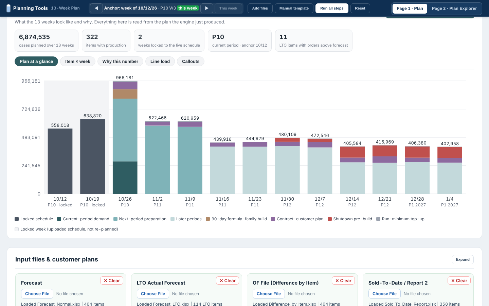
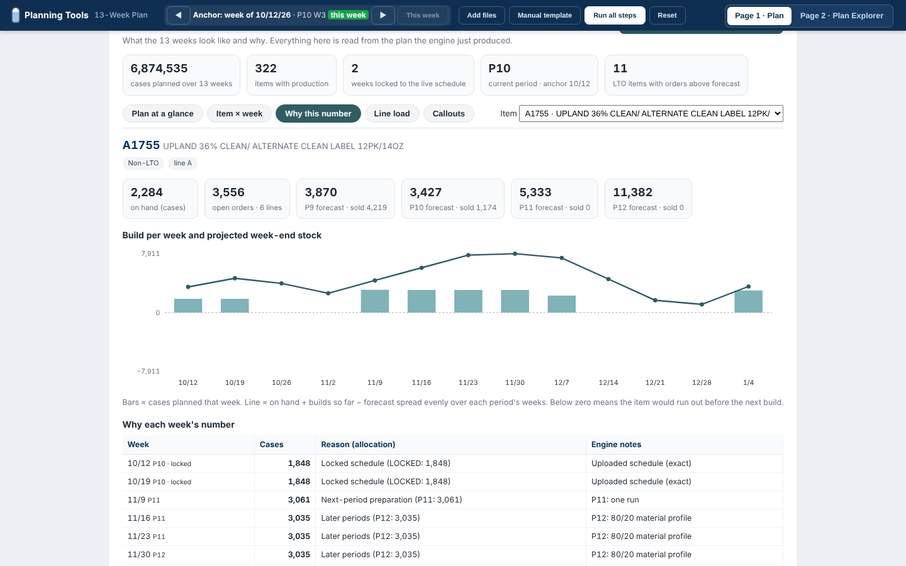

# 13-Week Plan

**A calendar-driven 13-week production plan, with the reason behind every number.** It reads the plant's daily exports and the two live schedule weeks, locks those weeks, plans the next eleven week by week, and shows why each item got each quantity.



[Open the demo](./index.html) · it loads the sample plant and runs the plan on open (about 15 seconds). The upload area and settings are below the results.

## The problem

The 13-week plan was rebuilt in Excel every week from the same ERP exports: forecast by period, sold-to-date, open orders, on hand, the schedules already in motion and three contract customers' own plans. It took most of a day, the rules lived in the planner's head (period deadlines, pickup lead time, formula-family builds, shutdown pre-builds, run minimums), and once the sheet was out nobody could say why a week's number was what it was.

## The views

The engine runs in five steps and then the results view reads its output:

| View | What it shows |
|------|---------------|
| [Plan at a glance](./index.html) | Stacked weekly cases by reason: locked schedule, current-period demand, next-period preparation, later periods, 90-day formula-family builds, contract-customer plans, shutdown pre-builds, run-minimum top-ups. |
| Item × week | Every item with production, biggest first, by week. Grey columns are the locked schedule weeks. Click a row for the reason. |
| Why this number | For one item: on hand, open orders, forecast vs sold per period, the build per week, the projected week-end stock line, the allocation each week came from and the engine's own notes. |
| Line load | Cases per line per week against the plan's capacity settings, with shutdown and holiday weeks shaded. |
| Callouts | Orders above the LTO forecast (not built automatically), LTO seasons with unsold forecast, items with forecast gaps, open orders with no forecast, negative on hand, combo items. |
| Engine steps | The tool's own five-step log: inputs check, requirement by period, placement, adjustments, validate & export. Downloads the plan workbook and the handoff file. |



## Where it's used

- Builds the 13-week master production schedule for 4 lines across 3 sites, refreshed every week.
- The planning rules are written down in the engine and applied the same way every week instead of from memory.
- Every number can be traced back to its reason: locked schedule, current demand, next-period preparation, formula-family builds or contract-customer plans.
- Callouts surface orders above forecast, forecast gaps and negative on hand before the plan goes to the floor.

## Inputs → logic → outputs

```
Inputs (xlsx)                               Engine (five steps)                         Outputs
──────────────────────────────────          ───────────────────────────────────         ──────────────────────────────
Master code, Item line master          ─┐   1 Inputs check: anchor week, current        Weekly plan: item × 13 weeks
Forecast normal + LTO (this + next yr)  │     period, locked weeks, customer plans       with source and allocations
Difference by item (OF), Sold-to-date   │   2 Requirement: per period, forecast or      Results view (this page)
Product availability (open orders)      ├─▶   OF minus sold minus on hand, 5-day   ─▶   Plan workbook (ZIP) in the
On hand + PO, Equivalent on hand        │     pickup rule for open orders               plant's existing format
Bill of materials                       │   3 Placement: locked weeks exact, demand     Handoff file (small)
This week + next week schedules         │     into open weeks before period deadline    Callouts list
Three contract-customer plans           │   4 Adjustments: 90-day family builds, run
Shutdown / holiday settings            ─┘     minimums, batch top-ups, pre-builds
                                            5 Validate & export: hard failures, warnings
```

## My role

I built the weekly plan by hand before this existed and I run this tool every week now. I specified the calendar (periods of 4–5 weeks, deadlines, anchor week), every planning rule and its order, the treatment of the locked schedule weeks and the three contract customers, and the output format. I validated each release against the plan I would have built by hand and against what the plant actually produced.

> Designed, specified and validated by me on live production data. Built with an AI coding assistant.

## Tech notes

- One HTML file, no build step; SheetJS and JSZip run in the browser. The engine is deterministic: same files, same plan.
- This demo adds a loader (fetches the sample files, sets the anchor week, runs the engine), a fixed clock (Oct 14, 2026) and the results view on top of the engine's output. The planning logic is unchanged.
- The three contract-customer plans and next year's forecast files were synthesised in the customers' file layouts from the sample dataset; see [REPLACEMENTS.md](REPLACEMENTS.md).
- Codes in the demo are `A####`; lines are A–D; capacity settings are the demo's own.
