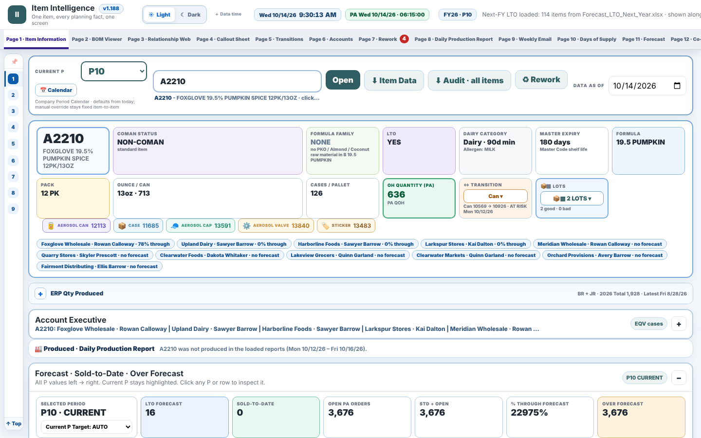

# Item Intelligence

**One item, every planning fact, one screen.** Type an item code and the page shows its forecast, sold-to-date, on hand, open orders, bill of materials with material stock, lots and expiry, packaging transitions, where it sits on this week's and next week's schedule, and what was produced this week.



[Open the demo](./index.html) · it loads the sample plant on open (about 10 seconds, showing each file it reads and the pages it feeds) and starts on item A2210. Press **Present** on the bottom bar for a click-through tour: arrow keys, Space or a presentation clicker move through it, and it loops.

## The problem

Every planning question at the plant touched the same half-dozen ERP exports: the forecast, the sold-to-date report, product availability (open orders), on hand and purchase orders, the bill of materials, lots on hand, plus the week's production schedule. Answering "can we run A2210 next week, and should we?" meant opening all of them, filtering each to one item and reconciling the numbers by hand, for every item, every day. The same files also fed the daily production report and the weekly schedule email, which were rebuilt by hand too.

## The pages

| # | Page | What the planner gets |
|---|------|-----------------------|
| 1 | [Item information](./index.html#item-information) | Everything about one item: status, pack, formula family, forecast vs sold by period, open orders, on hand, days of supply, a tunable safety-stock suggestion, materials with tightest-material flag, lots, account executives selling it. Hover the ⓘ on any key number to see how it is worked out. |
| 2 | [BOM viewer](./index.html#bom-viewer) | The item's bill of materials as a tree, with on hand and open purchase orders for each component, and what else uses them. |
| 3 | [Relationship web](./index.html#relationship-web) | Where-used in both directions: item → materials, material → items, combo parents and children. |
| 4 | [Callout sheet](./index.html#callout-sheet) | For the next weeks: items with orders above forecast, items with no forecast, items whose tightest material runs out before the pickup date. Copyable as a list. |
| 5 | [Transitions](./index.html#transitions) | Packaging and code transitions: which lots and materials belong to the old code, when the new one starts, what to run out first. |
| 6 | [Accounts](./index.html#accounts) | Forecast vs sold by account executive and customer, so over- and under-forecast accounts are visible before the period closes. |
| 7 | [Rework](./index.html#rework) | Rework candidates and the rework plan, built from the same lot and order data. |
| 8 | [Daily production report](./index.html#daily-production-report) | Loads the daily production reports and the weekly schedules; shows produced vs scheduled by day, line and item, holds and plant summary. |
| 9 | [Weekly email](./index.html#weekly-email) | Builds the weekly schedule email from this week's schedule workbook, with callouts, and lets you edit the sheet in place and download it. |
| 10 | [Days of supply](./index.html#days-of-supply) | Days of supply per item and per material, on hand and on hand + purchase orders, with the tightest material for each item. |
| 11 | [Forecast](./index.html#forecast) | This year, next year or both, in cases or equivalent: normal vs LTO vs contract-customer forecast by period, the LTO breakdown, top items, and a customer / item review that flags forecast moves above a set size. |
| 12 | [Contract customers](./index.html#contract-customers) | Each contract customer's own weekly plan exactly as their file gives it, one row per item, scrollable by week. Click a week to highlight it across customers with totals; double-click an item to open it on page 1. |

## Where it's used

- Used for weekly planning in a multi-site food plant: 4 production lines across 3 sites.
- One search replaces looking an item up across six separate ERP exports.
- Orders above forecast, items with no forecast and materials that run out before pickup are flagged on one callout sheet before the schedule is released.
- The daily production report and the weekly schedule email are built from the same files instead of being rebuilt by hand.

## How it compares with general inventory-planning software

General inventory-planning tools are built to forecast and reorder for many kinds of business. This one was built for a single job, planning an aerosol production plant day to day, so it goes deeper where that job needs it and leaves the rest to the systems built for it.

**Where it goes further**

- **Same-morning data, in seconds.** It reads the morning's exports as they are, in about 10 seconds. Planning tools that sync from the ERP often refresh on an overnight schedule.
- **Down to the line and the shift.** This week's and next week's line schedules and the daily production reports sit next to demand, so what is needed, what is planned and what was made are on one screen.
- **Shortage dates from real orders.** Finished-goods days of supply walks the open orders by pick date until on hand runs out, next to the forecast-pace view.
- **Shelf life by lot.** Each lot is checked against its expiry and the forecast pace, first-expiry-first-out, with the dairy / non-dairy minimum-days rule.
- **Contract customers' own plans.** Each contract customer's weekly command file is read in its own layout and drives proposed production for their items.
- **Packaging the way the plant counts it.** Cans per case including scrap, 12-pack equivalents, shared materials, combo packs built from single packs, and packaging switches with the old stock they would leave behind.
- **Production minimums.** Proposed runs respect pallet and batch minimums.
- **Safety stock you can tune.** A suggested buffer per item, sized from how much sales have missed the forecast, with service level and reaction time to adjust. It is shown beside the plan, so the planner decides.
- **Every number shows its working.** A small ⓘ on each key figure opens the inputs and the arithmetic behind it.
- **Ready-to-send outputs.** The callout sheet, the weekly schedule email and the rework email come out ready to paste.
- **Nothing to install.** One file that opens in a browser. The data never leaves the computer and nothing is stored.

**What it leaves to dedicated systems**

Purchase-order automation, statistical demand forecasting, multi-site stock balancing and user management stay with the ERP and the planning systems built for them. This tool reads their output and turns it into decisions for the plant floor.

## Inputs → logic → outputs

```
ERP exports (xlsx)                      Logic (in the browser)                  Outputs
──────────────────────────────          ─────────────────────────────────       ────────────────────────────
Master code / weights & measures   ─┐   join everything on item code            Item page (1), BOM tree (2),
Forecast (normal + LTO)             │   period calendar (P1–P12, 4-5 weeks)     where-used web (3)
Sold-to-date, Difference by item    │   forecast vs sold, over-forecast         Callout sheet (4) with copy
Product availability (open orders)  ├─▶ open orders vs forecast per period  ─▶  Transitions view (5)
On hand + PO, Equivalent on hand    │   tightest material = min over BOM        Accounts view (6)
Bill of materials (two layouts)     │   of (on hand + PO due) ÷ need            Rework plan (7)
Lots on hand, Packaging transition  │   lot expiry vs pickup, transition rules   Daily production report (8)
Production schedules (this/next wk) │   schedule rows → runs per item/line      Weekly email + edited xlsx (9)
Daily production reports           ─┘   produced vs scheduled per day            Days of supply tables (10)
```

Nothing leaves the browser. Each page reads the loaded workbooks with SheetJS and recomputes when a file is replaced.

## My role

I planned production at the plant and I am the user of this tool. I decided which files it reads, what each page shows and in what order, wrote the rules (period calendar, tightest-material definition, callout thresholds, transition handling), and validated every page against the live exports and what the plant actually ran, page by page, over several months of daily use.

> Designed, specified and validated by me on live production data. Built with an AI coding assistant.

## Tech notes

- One HTML file, no build step, no server; SheetJS reads the Excel exports in the browser. Pages 7–9 are sealed sub-apps inside the same file.
- This demo adds a loader that fetches the sample files from `data/` on open, fixes the clock to the snapshot morning (Oct 14, 2026), and routes each page to its own URL hash. The planning logic is unchanged.
- Sample data: 815 finished items (486 aerosol items with full detail), 5 daily production reports, 2 schedule weeks. See [REPLACEMENTS.md](REPLACEMENTS.md) for what was replaced and how.
- Codes in the demo are `A####` (suffix kept, e.g. `A2210-S`); lines are A–D.
